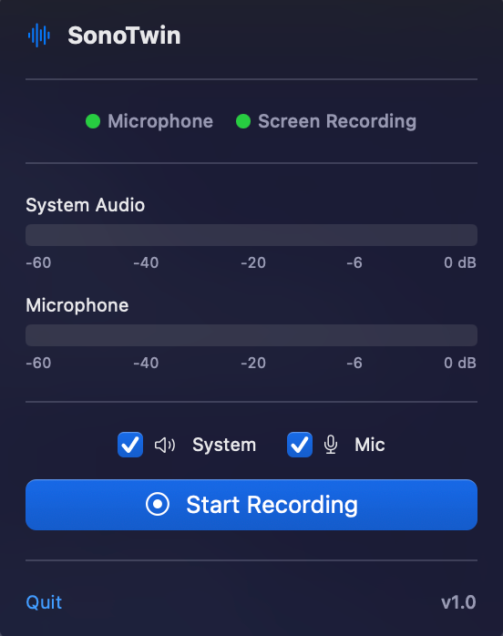
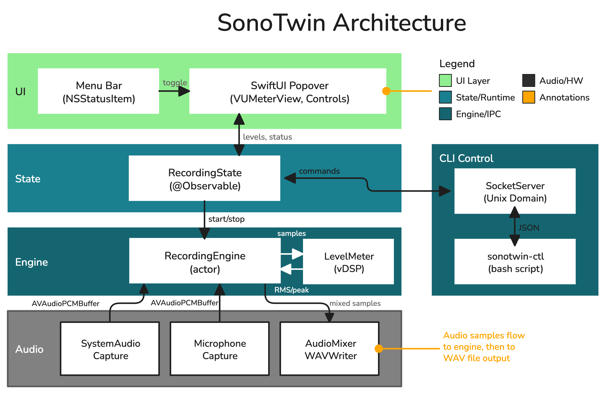

# SonoTwin Menu Bar App

> **Note:** This project was entirely generated by AI (Claude) as an experiment
> in AI-assisted software development. The code, documentation, and architecture
> were created through conversational prompts without manual coding.

A macOS menu bar application for recording system audio and microphone with
real-time VU meters.

Recordings are saved in `~/Documents` by default



## Features

- **Menu Bar Integration** - Lives in the menu bar with a waveform icon, no Dock
  icon
- **Real-time VU Meters** - Shows audio levels using Accelerate-optimized
  RMS/peak calculation
- **Permission Management** - Visual indicators and easy access to grant
  permissions
- **CLI Control** - Control recordings via `sonotwin-ctl` command-line tool
- **Mixed Recording** - Record system audio, microphone, or both simultaneously

## Build & Run

From the project root:

```bash
# Build
make build

# Test
make test

# Run
make run
# Or: open SonoTwinApp/SonoTwinApp.app
```

## CLI Control

While the app is running, use `sonotwin-ctl` from the project root:

```bash
# Check status
./sonotwin-ctl status

# Start recording
./sonotwin-ctl start --output ~/Desktop/recording.wav

# Start with options
./sonotwin-ctl start --system-only --duration 60 --output meeting.wav
./sonotwin-ctl start --mic-only --output voice.wav

# Stop recording
./sonotwin-ctl stop
```

## Architecture



### Concurrency Model

See [concurrency-model.excalidraw](Assets/concurrency-model.excalidraw) for a
detailed diagram explaining threads, actors, and delegates.

```
SonoTwinApp/Sources/SonoTwinApp/
├── App/
│   ├── SonoTwinApp.swift        # @main entry point
│   └── AppDelegate.swift         # NSStatusItem + NSPopover management
│
├── Core/                         # Audio capture (from CLI codebase)
│   ├── SystemAudioCapture.swift  # ScreenCaptureKit wrapper
│   ├── MicrophoneCapture.swift   # AVCaptureSession wrapper
│   ├── AudioMixer.swift          # Mixes two audio streams
│   └── WAVWriter.swift           # WAV file output
│
├── Audio/
│   ├── RecordingEngine.swift     # Orchestrates capture → mix → write
│   └── LevelMeter.swift          # RMS/peak using Accelerate framework
│
├── State/
│   ├── RecordingState.swift      # @Observable app state
│   └── PermissionManager.swift   # Mic & screen recording permissions
│
├── UI/
│   ├── PopoverContentView.swift  # Main popover layout
│   ├── VUMeterView.swift         # Gradient meter with peak indicator
│   ├── RecordingControlsView.swift
│   └── PermissionStatusView.swift
│
└── Socket/
    ├── SocketServer.swift        # Unix socket listener
    └── CommandHandler.swift      # JSON command processing
```

## Component Details

### App Layer

**SonoTwinApp.swift**

- Uses `NSApplication` directly (not SwiftUI App lifecycle)
- Sets `activationPolicy(.accessory)` to hide from Dock

**AppDelegate.swift**

- Creates `NSStatusItem` with SF Symbol icon
- Manages `NSPopover` with SwiftUI content via `NSHostingController`
- Initializes `RecordingEngine` and `SocketServer`

### Audio Layer

**RecordingEngine**

- Coordinates `SystemAudioCapture`, `MicrophoneCapture`, `AudioMixer`, and
  `WAVWriter`
- Processes audio buffers through `LevelMeter` for VU display
- Sends level updates to UI at 30fps via callback

**LevelMeter**

- Uses `vDSP_rmsqv` for efficient RMS calculation
- Uses `vDSP_maxmgv` for peak detection
- Applies smoothing for stable meter display
- Converts to dB scale (-60 to 0 dB range)

### State Layer

**RecordingState** (`@Observable`)

- Holds all UI-visible state: `isRecording`, `elapsedTime`, audio levels
- Holds settings: `recordSystemAudio`, `recordMicrophone`, `duration`
- Provides `startRecording()` / `stopRecording()` methods

**PermissionManager** (`@Observable`)

- Tracks `microphonePermission` and `screenRecordingPermission` states
- Provides methods to request permissions or open System Settings

### UI Layer (SwiftUI)

**PopoverContentView**

- Main container assembling all UI components
- Uses `@Bindable` to connect to `RecordingState`

**VUMeterView**

- Gradient bar from green → yellow → orange → red
- White/orange/red peak indicator based on level
- dB scale labels at bottom

**RecordingControlsView**

- Checkbox toggles for audio sources
- Large Start/Stop button with recording indicator
- Elapsed time display during recording

**PermissionStatusView**

- Green/yellow/red circles for each permission
- "Grant" or "Settings" buttons based on state

### Socket Layer

**SocketServer**

- Listens on `/tmp/sonotwin.sock`
- Accepts connections in background thread
- Dispatches to `CommandHandler` for processing

**CommandHandler**

- Parses JSON commands: `{"action": "start|stop|status", ...}`
- Returns JSON responses: `{"success": true, "recording": false, ...}`
- Interacts with `RecordingState` on MainActor

## JSON Protocol

### Commands

```json
// Start recording
{"action": "start", "output": "/path/to/file.wav", "duration": 60, "systemAudio": true, "microphone": false}

// Stop recording
{"action": "stop"}

// Get status
{"action": "status"}
```

### Responses

```json
{
  "success": true,
  "recording": true,
  "elapsedSeconds": 42,
  "outputPath": "/path/to/file.wav",
  "error": null
}
```

## Key Swift Concepts Used

- **@Observable** (macOS 14+) - Modern observation for SwiftUI
- **@MainActor** - Ensures UI updates happen on main thread
- **actor** - Thread-safe state isolation (considered but not used due to Timer
  complexity)
- **async/await** - Asynchronous permission requests and audio capture
- **NSLock** - Thread synchronization for audio callbacks
- **Accelerate/vDSP** - SIMD-optimized audio level calculation

## Permissions

The app requires:

- **Microphone** (`NSMicrophoneUsageDescription`) - For microphone recording
- **Screen Recording** (`NSScreenCaptureUsageDescription`) - For system audio
  via ScreenCaptureKit

Both are declared in `SonoTwinApp.app/Contents/Info.plist`.
